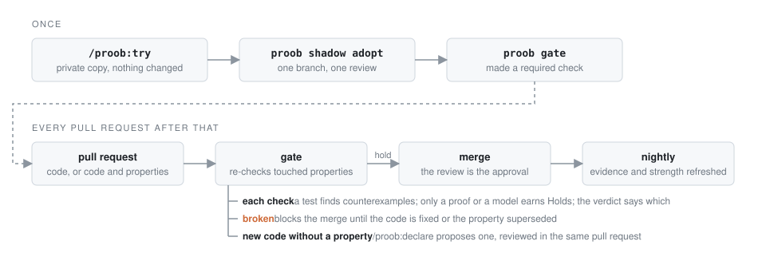

<!-- translated from README.md sha256:31b98dedf7b85a28427f9071439255d12b2a2d7000b621c9a9dc7fef4d5bca1f -->
# proob

[](https://github.com/proob-ai/proob/actions/workflows/ci.yml)
[](LICENSE)

[English](README.md) · [简体中文](README.zh-CN.md) · **日本語**

**平易な言葉で書いたコードの保証。AI エージェントが提案し、チームが承認し、すべてのプルリクエストで機械が検査します。**

どのコードベースにも、誰も書き留めていないルールがあります。返金額は請求額を超えない。バージョン文字列はパースし直しても同じバージョンになる。次のリリース番号はいつも前より大きい。テストは誰かが思い出したケースしかカバーしません。proob はそうしたルールを一文ずつ*プロパティ*として書き出し、それぞれに、何千もの生成した入力でそれを破るケースを探すチェックを付けます。それ以降、ルールを破ったプルリクエストが、失敗するプルリクエストになります。


Claude Code で python-semver に対して実際に実行した様子です。メンテナーが [issue #497](https://github.com/python-semver/python-semver/issues/497) を修正する一つ前のコミットまで巻き戻しています。コマンド一つ、5 分。proob は 5 つのプロパティを提案し、それぞれにチェックを書いて実行し、メンテナーが後に修正したバグを見つけました。*次の*プレリリース版を求めると*古い*バージョンが返ることがあったのです。バージョンのハッシュにもう一つ見つけました。リポジトリには何も触れていません。

## なぜ proob か

- **プロパティはすべての入力をカバーし、テストは一つをカバーする。** 「バージョンを表示してパースし直すと同じバージョンになる」は、誰かが打ち込んだ 3 つではなく、生成された何千ものバージョンで検査されます。
- **何を数えるかはチームが決める。** エージェントは提案するだけです。プロパティは、チームメイトが通常のプルリクエストのレビューで承認して初めて有効になり、proob はその承認を毎回 GitHub から読み取るので、エージェントにも単独のマージにも偽装できません。
- **緑には意味がある。** proob はコードを変異させて、各チェックが実際に失敗しうることを確かめます。何があっても通るチェックは、証明ではなく弱いものとして報告されます。

## 本当にバグを見つけるのか

人気のある Python と Rust のライブラリから 15 件のバグを集めました。more-itertools、cattrs、packaging、tomlkit、bytes、time などです。どれもライブラリ自身のテストスイートをすり抜け、後にメンテナーが修正したものです。各ライブラリを修正前のコミットまで巻き戻し、何か問題があるという手がかりなしに proob を実行しました。

**15 件中 14 件を見つけました。** そのうち 10 件は AI モデルの学習データの終わりより後に修正されたもので、覚えていたはずがありません。その 10 件中 9 件を見つけました。

attrs、rich、vaultwarden、python-semver、rust-url、tomlkit の現行リリースで実行すると、**コードにまだ残っていた 12 件のバグ**を見つけました。報告する失敗のおよそ 7 件に 6 件は実際のバグです（59 件中 50 件）。残りは、ライブラリが約束していないことを前提にしたチェックでした。

一部はだますために作った 501 の模擬シナリオで、proob は**破られたプロパティを成り立つと報告したことが一度もありません**。

見つけたバグはそれぞれ回帰テストになり、CI が AI なしで再生するので、proob はこっそり悪くなれません。測り方とすべての数値：[docs/benchmark.md](docs/benchmark.md)。

## クイックスタート

Claude Code で、あなたのリポジトリの中で：

```text
/plugin marketplace add proob-ai/proob
/plugin install proob@proob
/proob:try
```

`/proob:try` は `~/.proob/shadow/` 以下の非公開コピーで動くため、あなたのファイル、`.git`、`git status` はそのままです。pytest、Hypothesis、mutmut を入れた Python、または cargo-nextest と cargo-mutants を入れた Rust が必要です（[詳細](docs/guide.md#install)）。

結果が気に入ったら、レポートの最後にそれを残す 3 つの手順があります：

1. `proob shadow adopt` がプロパティ、そのチェック、2 つのワークフローを新しいブランチに置きます。
2. プルリクエストを開きます。チームメイトのレビューが承認です。
3. デフォルトブランチで `proob gate` チェックを必須にします。

## 仕組み

proob が今あるループに加えるのは、必須チェック一つとレビューの習慣一つだけです。その後は、チームが合意したすべてのルールが変更のたびに再検査され、ルールを破る変更はマージできず、どのルールもカバーしていない新しいコードは指摘されますが、決してブロックされません。

<picture>
  <source media="(prefers-color-scheme: dark)" srcset="docs/flow-dark.svg">
  
</picture>

| スキル | 内容 |
|---|---|
| `/proob:sense` | エージェントがコードを読む |
| `/proob:declare` | プロパティを平易な言葉のファイルとして提案し、チームがレビューするプルリクエストに入れる |
| `/proob:falsify` | 承認された各プロパティをプロパティベーステスト、または Rust では [Verus](https://github.com/verus-lang/verus) の証明に紐付ける |
| `/proob:verify` | proob がコードを変異させ、各チェックが実際に失敗しうることを示す |
| `/proob:guard` | プルリクエストごと、毎晩、セッションごとに、どのプロパティがまだ成り立つかを示す |

各プロパティの状態は `Holds`、`Checked`、`Not checked`、`Re-approve`、`Broken`、`Proposed`、`Waived` のいずれかです。`Holds` は、作成者以外のレビュアーが承認し、デフォルトブランチからの新しい証拠があり、チェックが失敗しうることが示されていることを意味します。`Holds` は証明またはモデルに限られ、プロパティベーステストは `Checked (tested)` までです。レビューするだけのチームメイトには GitHub だけで足ります。各スキル、状態、チーム設定、CLI は[ガイド](docs/guide.md)（英語）にあります。

## エージェントはずるができるか

できません。

- **承認はリポジトリに保存されません。** 状態を表示するたびに GitHub のレビュー記録から読み取り、2 人目のレビュアーなしでマージされた変更は決して数えません。
- **証拠はデフォルトブランチからのみ、** トークンを持たないジョブが生成します。
- **承認と証拠を判定に変えるコードは、機械的に正しさが証明されています。** テストだけでなく Verus で証明されています。その証明の対象である [6 つの表明](crates/proob-core/ASSERTIONS.md)は、コーヒー一杯のあいだに読める長さです。

## ロードマップ

**MVP。** プロパティベーステストと形式検証を同じチェックの 2 つの種類として扱う一つのコアと、その周りの一つのループ：

- [x] **コードベースの最初の宣言を共同で書く。** エージェントがコードを読んでルールを提案し、チームがプルリクエストで承認する
- **宣言からチェックを生成する。** テストが見逃すバグを捕まえるために
  - [x] プロパティベーステストとして、Python と Rust で
  - [x] 証明として、Verus で書かれた Rust で
  - [x] 普通の Rust でも証明として、証明を書かずに（Kani）
  - [x] 設計の形式仕様として、TLC でモデル検査（TLA+）。データモデル向けの Alloy は次に対応
  - [ ] 検証を優先し、安全な着地も用意する。どの検証器もあるルールを扱えないとき（未対応の機能、無限ループ、タイムアウト）、エージェントは代わりにプロパティベーステストを紐付け、そう明示する
  - [x] 判定がテスト済みと証明済みを区別する。`Holds` は証明済みを意味し、テストは `Checked (tested)` と表示される
- [x] **すべてのプルリクエストを見張る。** 承認済みのルールを破るものはマージされない
- **ルールとコードのずれを見張る。** ルールが、もはや記述していないコードに対して黙って承認済みのままになることはない
  - [x] ルールやそのチェックが変わったら、再承認が必要
  - [x] どのルールもカバーしない新しいコードはプルリクエストで指摘される
  - [x] 設計仕様から離れたコードは、ルールに更新と再承認のフラグを立てる

**その後**

- [ ] TypeScript で使う。次に Go と Java
- [ ] 監査人に、オフラインでも単独で成り立つ判定を渡す（署名付き証拠）
- [ ] すべてのリポジトリを一度に見張る。承認は引き続き GitHub から読む

### 対応言語

**テストはバグを見つけ、`Holds` を得られるのは検証器だけです。** 各プロパティはチェックを一つ紐付けます。プロパティベーステストは生成した入力から反例を探します。見つければ `Broken`、見つからなければ `Checked (tested)` です。サンプルした実行はすべての入力について語れないからです。証明やモデル検査器はすべての入力をカバーするので、それだけが `Holds` を表示できます。Kani の証明はハーネスが設ける範囲内のすべての入力をカバーし、判定もそう明記します。判定はつねに、どの種類の証拠が背後にあるかを示します。あまりに簡単に受け入れる検証器は、弱いテストと同じ方法で捕まえます。proob は証明の下でコードを変異させ、それでも通る証明は、成り立つではなく空虚として報告されます。

☑ 構築済み、☐ 計画中。

| 言語 | 形式検証 | プロパティベーステスト |
|---|---|---|
| Rust | ☑ Verus、Verus コード向け · ☑ Kani、あらゆる Rust 向け | ☑ proptest |
| Python | | ☑ Hypothesis |
| 設計レベル、任意の言語 | ☑ TLA+ と TLC · ☐ Alloy | |
| TypeScript | | ☐ fast-check |
| Go、Java | | ☐ |

Python には証明の経路がありません。Python のプロパティは Hypothesis でチェックされ、最高でも `Checked (tested)` と表示されます。

TLA+ のモデルが成り立つのは、その定数の範囲での設計に対してであり、コードに対してではありません。モデル化したコードに変更があれば、再承認のフラグが立ちます。

その他の言語でも sense と declare は使え、各プロパティは `Not checked (no adapter)` と表示されます。既知の制限は[ガイド](docs/guide.md#limits)にあります。

## コントリビュート

質問は [Discussions](https://github.com/proob-ai/proob/discussions) へ、バグは [issues](https://github.com/proob-ai/proob/issues) へ、脆弱性は非公開のセキュリティアドバイザリへ（[`SECURITY.md`](SECURITY.md)）。`master` へのプルリクエストを歓迎します。[`CONTRIBUTING.md`](CONTRIBUTING.md) がチェックを説明し、`cargo xtask ci` がすべてを実行します。英語の README を編集したら、各 `README.<language>.md` とそのソースハッシュを更新してください。`cargo xtask readme-sync` が一致を確認します。

## ライセンス

[Apache-2.0](LICENSE) © proob-ai
