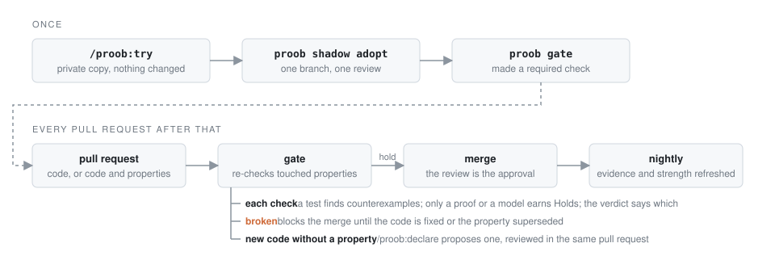

# proob

[](https://github.com/proob-ai/proob/actions/workflows/ci.yml)
[](LICENSE)

**English** · [简体中文](README.zh-CN.md) · [日本語](README.ja.md)

**Plain-English guarantees for your code: an AI agent proposes them, your team approves them, and machines check them on every pull request.**

Every codebase has rules nobody wrote down. A refund never exceeds the charge. A version string parses back to the same version. The next release number is always higher than the last. Tests cover the cases someone remembered. proob writes those rules down as *properties*, one sentence each, and gives each one a check that tries thousands of generated inputs looking for the case that breaks it. From then on, the pull request that breaks a rule is the one that fails.


A real run in Claude Code on python-semver, rolled back to the commit before its maintainers fixed [issue #497](https://github.com/python-semver/python-semver/issues/497). One command, five minutes. proob proposed five properties, wrote and ran a check for each, and found the bug the maintainers later fixed: asking for the *next* prerelease could hand back an *older* version. It found a second one too, in version hashing. Nothing in the repository was touched.

## Why proob

- **A property covers every input; a test covers one.** "Printing a version and parsing it back gives the same version" is checked against thousands of generated versions, not the three someone typed.
- **Your team decides what counts.** The agent only proposes. A property is live only after a teammate approves it in an ordinary pull request review, and proob reads that approval from GitHub every time, so neither the agent nor a solo merge can fake it.
- **Green means something.** proob mutates your code to confirm each check can fail. A check that passes no matter what is reported as weak, not as proof.

## Does it find real bugs?

We collected 15 bugs from popular Python and Rust libraries, among them more-itertools, cattrs, packaging, tomlkit, bytes, and time. Each had slipped past the library's own test suite and was later fixed by its maintainers. We rolled each library back to the commit before the fix and ran proob with no hint that anything was wrong.

**It found 14 of the 15.** Ten of those bugs were fixed after the AI model's training data ends, so it could not have remembered them. It found 9 of the 10.

Run on the current releases of attrs, rich, vaultwarden, python-semver, rust-url, and tomlkit, it found **12 bugs that were still in the code**. About six of every seven failures it reports are real bugs (50 of 59). The rest were checks that assumed more than the library promises.

In 501 simulated scenarios, some built to trick it, proob **never once reported a broken property as holding**.

Every bug it finds becomes a regression test that CI replays with no AI involved, so proob cannot quietly get worse. How we measure, and every number: [docs/benchmark.md](docs/benchmark.md).

## Quick start

In Claude Code, inside your repository:

```text
/plugin marketplace add proob-ai/proob
/plugin install proob@proob
/proob:try
```

`/proob:try` works on a private copy under `~/.proob/shadow/`, so your files, your `.git`, and `git status` stay exactly as they were. You need Python with pytest, Hypothesis, and mutmut, or Rust with cargo-nextest and cargo-mutants; `/proob:setup` installs what is missing ([details](docs/guide.md#install)).

If you like what it found, the report ends with three steps to keep it:

1. `proob shadow adopt` puts the properties, their checks, and two workflows on a new branch.
2. Open a pull request. A teammate's review is the approval.
3. Make the `proob gate` check required on your default branch.

## How it works

proob adds one required check and one review habit to the loop you already have. After that, every rule your team agreed on is re-checked on every change, a change that breaks one cannot merge, and new code no rule covers is pointed out, never blocked.

<picture>
  <source media="(prefers-color-scheme: dark)" srcset="docs/flow-dark.svg">
  
</picture>

| Skill | What happens |
|---|---|
| `/proob:sense` | the agent reads your code |
| `/proob:declare` | it proposes properties as plain-English files, in a pull request your team reviews |
| `/proob:falsify` | it binds each approved property to a property-based test, or to a [Verus](https://github.com/verus-lang/verus) proof in Rust |
| `/proob:verify` | proob mutates the code to show each check can actually fail |
| `/proob:guard` | every pull request, every night, every session: which properties still hold |
| `/proob:setup` | it installs the tools your checks need on this machine, each step only after you say yes |

Every property gets one status: `Holds`, `Checked`, `Not checked`, `Re-approve`, `Broken`, `Proposed`, or `Waived`. `Holds` means approved by a reviewer other than the author, with fresh evidence from your default branch and a check shown able to fail. `Holds` is reserved for a proof or a model, and a property-based test reaches `Checked (tested)`. A teammate who only reviews needs nothing but GitHub. The [guide](docs/guide.md) covers each skill, the statuses, team setup, and the CLI.

## Can the agent cheat?

No.

- **Approval is never stored in the repository.** It is read from GitHub's review records each time a status is shown, and a change merged without a second reviewer never counts.
- **Evidence only comes from your default branch,** produced by a job that holds no token.
- **The code that turns approvals and evidence into a verdict is machine-proved correct**, with Verus, not just tested. The [six assertions](crates/proob-core/ASSERTIONS.md) it is proved against are short enough to read over coffee.

## Roadmap

**The MVP.** One core that treats a property-based test and a formal verification as two kinds of the same check, and one loop around it:

- [x] **Co-author the first declaration for your codebase.** The agent reads the code and proposes the rules; your team approves them in a pull request
- **Generate the checks from the declaration**, so they catch the bugs your tests miss
  - [x] as property-based tests, for Python and Rust
  - [x] as proofs, for Rust written in Verus
  - [x] as proofs on ordinary Rust, with no proofs to write (Kani)
  - [x] as a formal spec of your design, model-checked with TLC (TLA+); Alloy for a data model is next
  - [x] verification first, with a safe landing: where no verifier can take a rule (an unsupported feature, an unbounded loop, a timeout), the agent binds a property-based test instead, and says so
  - [x] with the verdict telling tested from proved: `Holds` means proved, a test reads `Checked (tested)`
- [x] **Watch every pull request.** Nothing that breaks an approved rule gets merged
- **Watch for drift between the rules and the code.** A rule never silently stays approved for code it no longer describes
  - [x] a rule or its check that changes must be approved again
  - [x] new code no rule covers is pointed out in the pull request
  - [x] code that moves away from its design spec flags the rule for update and re-approval

**After**

- [ ] Use it from TypeScript, then Go and Java
- [ ] Hand an auditor a verdict that stands on its own, offline (signed evidence)
- [ ] Watch every repository at once, with approvals still read from GitHub

### Languages

**A test finds bugs; only a verifier earns `Holds`.** Every property binds one check. A property-based test searches generated inputs for a counterexample: `Broken` when it finds one, `Checked (tested)` when it does not, because a sampled run cannot speak for every input. A proof or a model checker covers every input, so it alone can render `Holds`. A Kani proof covers every input within the bounds its harness sets, and the verdict says so. The verdict always says which kind of evidence stands behind it. A verifier that accepts too easily is caught the way a weak test is: proob mutates the code under the proof, and a proof that still passes is reported as vacuous, not as holding.

☑ built, ☐ planned.

| Language | Formal verification | Property-based test |
|---|---|---|
| Rust | ☑ Verus, for Verus code · ☑ Kani, for any Rust | ☑ proptest |
| Python | | ☑ Hypothesis |
| Design level, any language | ☑ TLA+ with TLC · ☐ Alloy | |
| TypeScript | | ☐ fast-check |
| Go, Java | | ☐ |

Python has no proof route: a Python property is checked with Hypothesis and reads `Checked (tested)` at best.

A TLA+ model holds for the design over its constants, not for the code; any change to the modelled code flags it for re-approval.

In any other language, sense and declare still work, and every property reads `Not checked (no adapter)`. Known limits are in the [guide](docs/guide.md#limits).

## Contributing

Questions go in [Discussions](https://github.com/proob-ai/proob/discussions), bugs in [issues](https://github.com/proob-ai/proob/issues), vulnerabilities to a private advisory ([`SECURITY.md`](SECURITY.md)). Pull requests into `master` are welcome; [`CONTRIBUTING.md`](CONTRIBUTING.md) explains the checks, and `cargo xtask ci` runs them all. After editing this README, update each `README.<language>.md` and its source hash; `cargo xtask readme-sync` confirms they match.

## License

[Apache-2.0](LICENSE) © proob-ai
